***Please feel free to raise any comments or issues on the [website's Github repository](https://github.com/wmutschl/mutschler.dev).
Pull requests are very much appreciated.***



## Overview



This post is a map of my backups, for me and for my relatives.
It says which copies of my data exist, where they live, when they are made, how I notice that something failed, and where I would restore from.
It does not repeat commands.
Each part links to the guide that sets it up, and the scripts and configuration files are in my [scripts repository](https://github.com/wmutschl/scripts).

A lot has changed since the 2022 edition of this post.
I no longer use the Lenovo server, a ThinkSystem SR655 that I ran for my research.
The Dell and Honor laptops from back then are no longer part of my backups.
Nextcloud ran on my Mac mini for a while before it moved to the Wyse.
Since November 2026, a [Dell Wyse 5070 Thin Client](/linux/wyse-ubuntu-nextcloud-aio/) at home is my server: it runs Nextcloud All-in-One (AIO), collects the backups of my [Raspberry Pi with Home Assistant](/linux/raspi-home-assistant-os/), and protects both with snapshots, two USB disks and an off-site mirror.
My Macs keep using Time Machine.

The principles stayed the same:

* **Sync is not a backup.**
  Nextcloud spreads a mistake to every device, so the server data needs versioned copies.
* **Go back in time.**
  Damaged files or malware can stay unnoticed for a while, so I keep hourly, daily, weekly and monthly versions.
* **Several copies in several places:** on the server, on separate disks, and outside the house.
* **Encryption at rest.**
  Every backup disk and the off-site copy are encrypted, so a lost, stolen or returned disk exposes nothing.
* **Every backup job I wrote reports to [healthchecks.io](https://healthchecks.io).**
  A missing ping is as loud as a failed one.
  AIO's own backup is the exception: it reports only failures, as a Nextcloud notification.
  modCraft's daily statistics export has no check either.
* **Everything is written down.**
  The guides on this site and the public scripts repository are what I would rebuild from.

This is how the pieces fit together:



## 1 The machines and their data

| Machine | What it holds | Where its data goes |
|---|---|---|
| **Dell Wyse 5070 Thin Client** (`dell-wyse`), home | Nextcloud AIO with our files; the Home Assistant backups; the Ubuntu host itself | Hourly snapshots on its SSD, daily to HDD 1 and (Nextcloud only) to HDD 2, daily off-site to a Hetzner Storage Box ([section 2](#2-the-copies)) |
| **Raspberry Pi 4 Model B** (`homeassistant`), home | Home Assistant OS, including the complete Zigbee network in Zigbee2MQTT's folder | Encrypted daily backups: 60 kept on the Pi, 7 on an SMB share on the Wyse, from where they follow the Wyse's own backups |
| **MacBook Pro M2 Max** (`macbook-pro`), home and office | My main work machine | Time Machine to a SanDisk Extreme Portable 4 TB at home and a LaCie 2 TB in the office; user files sync to Nextcloud |
| **MacBook Air M1** (`macbook-air`), home | My wife's laptop | Time Machine to a Crucial P1 1 TB in a USB-C enclosure; user files sync to Nextcloud |
| **Mac mini M4 Pro** (`mac-mini`), home | Research workstation; Gitea and my web app modCraft; my Photos library on a separate Samsung T7 1 TB | Time Machine to a Samsung T7 2 TB, including the Photos library; no Nextcloud sync |
| **iPhones and iPads** | Photos, messages, app data | iCloud Backup only |

The Wyse is the heart of it.
Its hardware is a Celeron J4105 with 32 GB RAM, a Verbatim Vi560 2 TB SATA SSD as the system disk (the built-in eMMC stays unused), and two bus-powered USB HDDs for backups ([hardware guide](/linux/wyse-hardware/)).
The SSD is a single disk, not redundant storage; the two HDDs and the off-site mirror are what protect it.
The SSD is LUKS2-encrypted with the BTRFS pool inside, and I type its passphrase over SSH into the initrd at every boot ([section 5.7 of the Wyse guide](/linux/wyse-ubuntu-nextcloud-aio/#57-unlocking-the-system-disk-over-ssh)).
The pool is split into subvolumes for the host, my home directory, Docker's data (AIO's database and configuration), the Nextcloud data and the Home Assistant backups ([section 1](/linux/wyse-ubuntu-nextcloud-aio/#1-the-intended-layout)).

The Mac mini runs Gitea and my web app modCraft ([Mac mini guide](/apple/mac-mini-gitea-modcraft/)).
Gitea mirrors my repositories on GitHub, GitLab and Dynare's GitLab, so it is my backup of them; it used to run on the Lenovo server.
Every night, a consistent Gitea backup and an export of modCraft's statistics go into folders that Time Machine copies ([section 10.3 of the Mac mini guide](/apple/mac-mini-gitea-modcraft/#103-what-the-backup-contains)).

## 2 The copies

These are the copies of the data on the Wyse:

| # | Copy | Where | Versions | Encrypted | Protects against |
|---|---|---|---|---|---|
| 1 | Live data, plus Nextcloud's own trash and file versions | Vi560 SSD in the Wyse | Nextcloud's versions only | LUKS2 | Nothing beyond a quick undo in Nextcloud |
| 2 | BTRBK snapshots | Same SSD | 48 hourly, 7 daily | LUKS2 | A deleted or overwritten file, a bad change on the host |
| 3 | BTRBK send/receive | HDD 1, WD Elements 6 TB, USB | 30 daily, 12 weekly, 12 monthly | LUKS2 | A dead SSD; mistakes noticed weeks or months later |
| 4 | AIO's Borg backup of Nextcloud | HDD 2, Toshiba 4 TB, USB | AIO's default: all of the last 7 days, 4 weekly, 6 monthly | Borg | A broken Nextcloud installation; the consistent copy to restore the application from |
| 5 | Mirror of the Borg repository and the HA backups | Hetzner Storage Box | 10 daily Storage Box snapshots | Borg and Home Assistant, before they leave the house | Fire, theft or a power surge that takes all three disks at home |

Some details matter:

* **Snapshots are crash-consistent.**
  They capture each subvolume as after a power cut.
  The database and the files are snapshotted a moment apart and can disagree slightly, so I restore the Nextcloud application from Borg, not from snapshots ([section 7 of the Wyse guide](/linux/wyse-ubuntu-nextcloud-aio/#7-backup-disks-snapshots-alerts-and-the-home-assistant-share)).
* **Borg is consistent.**
  AIO stops the containers while Borg runs ([section 10.1](/linux/wyse-ubuntu-nextcloud-aio/#101-aio-borg-backup-to-hdd-2)).
  The previews are excluded from it; HDD 1 still has them.
* **HDD 1 holds plain copies of everything,** including the host, so it is encrypted like the SSD.
  A keyfile on the encrypted SSD unlocks it at boot; its own passphrase is in my password manager ([section 7.2](/linux/wyse-ubuntu-nextcloud-aio/#72-prepare-the-two-hdds)).
* **HDD 2 is not LUKS-encrypted,** because Borg encrypts the repository itself.
* **The two HDDs hang off different internal USB hubs** of the Wyse, so one hub reset does not take out both.
* **The off-site copy is a mirror, not a second Borg repository.**
  Nothing writes to it except the nightly rsync.
  What protects it against a sync that copies damage or deletions are the Storage Box's own daily snapshots.
  I manage those only in the Hetzner Console; the Wyse's SSH key cannot touch them, so even a compromised Wyse cannot delete them ([section 7.6](/linux/wyse-ubuntu-nextcloud-aio/#76-off-site-mirror-on-a-hetzner-storage-box)).
* **None of these copies is offline.**
  HDD 1 and HDD 2 are always attached, and the Storage Box is always reachable from the Wyse.
* **The host is not in AIO's backup.**
  It lives in the snapshots and on HDD 1, and almost all of its configuration is in the public scripts repository; the secrets are in my password manager ([section 10.2](/linux/wyse-ubuntu-nextcloud-aio/#102-host-configuration-and-recovery-material)).

**Home Assistant** writes a full, encrypted backup every day ([Step 6 of the Home Assistant guide](/linux/raspi-home-assistant-os/#step-6-encrypted-backups-to-an-smb-share)).
It keeps 60 of them on the Pi for quick restores, but those die with its SD card/SSD.
It also uploads each backup to an SMB share on the Wyse, which keeps 7.
On the Wyse, the share is a subvolume of its own, so the backups are snapshotted hourly, reach HDD 1 with the next nightly send and go off-site with the mirror ([section 7.5 of the Wyse guide](/linux/wyse-ubuntu-nextcloud-aio/#75-backup-share-for-home-assistant)).
Pruned HA backups stay on HDD 1 for months.
The encryption key is in the emergency kit in my password manager; without it, none of these copies can be restored.

**My Macs** back up hourly with Time Machine to encrypted external disks that stay connected at home, and the MacBook Pro has a second one in the office.
On the two MacBooks, the Nextcloud desktop client syncs our user files to the Wyse ([macOS guide](/apple/macos-post-install/#nextcloud-free)), so they also end up in all five copies above.
The Mac mini does not sync to Nextcloud.
A few large folders on the Macs, such as `~/Movies`, are excluded from Time Machine ([macOS guide](/apple/macos-post-install/#restore-files-either-via-time-machine-nextcloud-or-rsync)).


**iPhones, iPads, calendars and contacts.**
Our iPhones and iPads are backed up only to iCloud, and our calendars and contacts live in iCloud as well.
Apart from the devices themselves, there is no second copy of them.


**Recovery material** lives in my password manager: the LUKS passphrases and header backups, AIO's passphrase and the Borg password, the Storage Box passwords, the Samba password, the healthchecks.io ping key, the Tailscale OAuth secret and the Home Assistant emergency kit.

## 3 A day of backups

The Wyse's timers run in its local time, Europe/Berlin.
AIO reads its backup time as UTC, and the Storage Box's snapshot time is UTC as well.

| When | Job | From → to | Reports to |
|---|---|---|---|
| Every five minutes | Uptime ping | – | healthchecks.io: `dell-wyse-alive` |
| Every minute | Home Assistant heartbeat | – | healthchecks.io |
| Hourly | BTRBK snapshot | Live subvolumes → snapshots on the SSD | healthchecks.io: `dell-wyse-btrbk-snapshot` |
| Daily, 01:30 | BTRBK send/receive | Snapshots → HDD 1 | healthchecks.io: `dell-wyse-btrbk-send` |
| Daily, at HA's "System optimal" time, between 04:45 and 05:45 | Home Assistant backup | Pi → share on the Wyse, then to HDD 1 with the next night's send | healthchecks.io: `dell-wyse-ha-backup-check` at 07:00; a repair in HA |
| Daily, 04:00 UTC on my Wyse (the guide's example is 03:00 UTC), i.e. 05:00 CET or 06:00 CEST | AIO's updates, then the Borg backup, then the containers start again | Nextcloud → HDD 2 | AIO notifies its administrators in Nextcloud if it fails |
| Daily, 06:30, once AIO's backup has finished | Off-site mirror | Borg repository and HA backups → Storage Box | healthchecks.io: `dell-wyse-offsite` |
| Daily, 13:00 UTC, i.e. 14:00 CET or 15:00 CEST | Storage Box snapshot, 10 kept | Inside the Storage Box | – |
| Daily, 02:30 | Gitea backup on the Mac mini (`pg_dump` and `gitea dump`) | Gitea → `~/Backups/gitea`, then Time Machine | healthchecks.io: `mac-mini-gitea-backup` |
| Daily, 03:30 | modCraft statistics export on the Mac mini | modCraft → its backups folder, then Time Machine | – |
| Hourly | Time Machine on each Mac | Mac → its Time Machine disk | macOS warns after days without a backup |
| Weekly | TRIM of the SSD | – | – |
| Sundays 11:00, and the 15th at 11:00 | SMART short and long self-tests | Vi560 and both HDDs | healthchecks.io: `dell-wyse-smartd`, failures only |
| Monthly, on the 1st at 10:00 | BTRFS scrub and error counters | Vi560 and both HDDs | healthchecks.io: `dell-wyse-scrub` |

The night looks roughly like this, in winter time (CET).
The bars show start times; their lengths are rough guesses and vary from night to night.

```mermaid
gantt
    title One night of backups in CET
    dateFormat HH:mm
    axisFormat %H:%M
    todayMarker off
    section Snapshots
    btrbk snapshot every hour :snap, 00:00, 480m
    section HDD 1
    btrbk send to HDD 1 :send, 01:30, 30m
    section Mac mini
    Gitea backup :gitea, 02:30, 15m
    modCraft statistics export :modcraft, 03:30, 5m
    section Home Assistant
    HA backup to the Wyse :ha, 04:45, 60m
    HA backup check :hacheck, 07:00, 10m
    section Nextcloud
    AIO Borg backup to HDD 2 :borg, 05:00, 90m
    section Off-site
    Mirror to the Storage Box :offsite, 06:30, 45m
```

A few rules connect these jobs:

* **The hourly snapshot and the daily send share a lock.**
  They wait for each other instead of failing.
  A long send therefore holds up the hourly snapshots, so those hours get no snapshot, and healthchecks.io reports the snapshot job as overdue until the send is done ([section 7.3](/linux/wyse-ubuntu-nextcloud-aio/#73-hourly-snapshots-and-daily-sendreceive-with-btrbk)).
* **The daily send catches up.**
  It sends every daily copy that HDD 1's retention still needs, including days on which HDD 1 was detached.
  It carries the first snapshot after midnight; later changes wait for the next night.
* **The off-site mirror waits for AIO.**
  It starts only once AIO's backup container and Borg's lock are gone, for up to four hours, and copies new data first and deletions last, so even an interrupted run leaves a usable repository.
* **Nextcloud is offline while AIO's backup runs.**
  How long depends on how much changed.
  After an upload of 219 GiB in November 2026, it ran from 05:00 to about 07:25.
* **Persistent timers.**
  Jobs that were due while the Wyse was off run right after the next boot; AIO's own backup does not, it skips the day.

## 4 Monitoring

Every `dell-wyse-*` job pings its own check on healthchecks.io when it succeeds.
When it fails, a second unit sends a failure ping with the job's last 40 log lines.
A job that never runs, because the Wyse is off, a disk is missing or a timer stopped, shows up as a missing ping ([section 7.1](/linux/wyse-ubuntu-nextcloud-aio/#71-alerts-to-healthchecksio)).

| Check | Period / grace | Watches |
|---|---|---|
| `dell-wyse-alive` | 5 minutes / 1 minute | The Wyse is up, online and its timers run |
| `dell-wyse-btrbk-snapshot` | 1 hour / 1 hour | Hourly snapshots; also fails while HDD 1 is missing |
| `dell-wyse-btrbk-send` | 1 day / 6 hours | Daily copy to HDD 1 |
| `dell-wyse-ha-backup-check` | 1 day / 2 hours | A Home Assistant backup newer than 26 hours is on the share; also catches a dead Pi or a broken share |
| `dell-wyse-offsite` | 1 day / 6 hours | Off-site mirror; also fails if the Borg repository has not changed in 26 hours |
| `dell-wyse-scrub` | 31 days / 2 days | Monthly scrub of all three disks, plus their error counters |
| `dell-wyse-smartd` | Failures only | SMART health, error logs, self-tests and temperature of all three disks |
| Home Assistant heartbeat | 1 minute / 5 minutes | Home Assistant is running ([Step 7](/linux/raspi-home-assistant-os/#step-7-healthchecksio-heartbeat)) |

Disk health is covered twice.
smartd watches the SSD and both HDDs and runs weekly and monthly self-tests, and the monthly scrub reads every block and checks the BTRFS checksums ([section 7.4](/linux/wyse-ubuntu-nextcloud-aio/#74-disk-health-monthly-scrub-and-smart-monitoring)).
A scrub finds errors on single-copy data but cannot repair them; that is what the HDD copies are for.

AIO reports a failed backup as a notification to the Nextcloud administrators, not to healthchecks.io.
Home Assistant shows a repair when an upload fails, and macOS warns when Time Machine has not run for days.

Besides the alerts, I look at disk usage, error counters, the latest BTRBK copies and the timers now and then, especially after an import or an update ([section 10.4](/linux/wyse-ubuntu-nextcloud-aio/#104-regular-checks)).
Before I reboot the Wyse, a small script tells me whether a send, the mirror, a scrub, an HA upload or AIO's daily run would be cut off ([section 11.3](/linux/wyse-ubuntu-nextcloud-aio/#113-reboot-the-wyse)).
Restore drills are in my calendar (below).

## 5 Restore paths

| What went wrong | Where I restore from | How |
|---|---|---|
| A deleted or overwritten file in Nextcloud | Nextcloud's trash and versions, then the snapshots on the SSD, then HDD 1 | Snapshots are read-only folders; copy the file back and let Nextcloud rescan ([section 7.3](/linux/wyse-ubuntu-nextcloud-aio/#73-hourly-snapshots-and-daily-sendreceive-with-btrbk), **Getting something back**) |
| A bad update or change on the host | Snapshots, or HDD 1 | Before risky changes, I stop Nextcloud and take a consistent snapshot by hand ([section 10.3](/linux/wyse-ubuntu-nextcloud-aio/#103-snapshots-around-risky-changes)) |
| A broken Nextcloud installation | AIO's Borg repository on HDD 2 | Path B: reinstall from an AIO backup ([section 9.4](/linux/wyse-ubuntu-nextcloud-aio/#94-path-b-reinstall-from-an-aio-backup)) |
| A dead SSD | HDD 1 for the host and the HA backups, HDD 2 for Nextcloud, the scripts repository and the password manager | Rebuild the Wyse with the guide, reuse the HDDs without formatting them ([section 7.2.2](/linux/wyse-ubuntu-nextcloud-aio/#722-rebuilding-the-wyse-reuse-the-hdds)), then Path B |
| A dead or damaged HDD 2 | Storage Box mirror | Stop the mirror job, copy the repository back, check it, then continue or restore through Path B ([section 7.7](/linux/wyse-ubuntu-nextcloud-aio/#77-restore-from-the-storage-box)) |
| A Borg repository that is damaged everywhere | HDD 1 | The daily copies of the Nextcloud data still hold every user's files ([section 9.4](/linux/wyse-ubuntu-nextcloud-aio/#94-path-b-reinstall-from-an-aio-backup)) |
| A mirror that copied damage | A Storage Box snapshot from before the damage | Read it through the main account, never with **Restore snapshot** in the Console ([section 7.7](/linux/wyse-ubuntu-nextcloud-aio/#77-restore-from-the-storage-box)) |
| The house loses all three disks | Storage Box plus password manager | Copy the mirror back onto a new disk, then Path B ([section 7.7](/linux/wyse-ubuntu-nextcloud-aio/#77-restore-from-the-storage-box)); the host comes from the guide and the scripts repository |
| A dead SD card/SSD in the Pi, or new hardware | Newest HA backup from the Wyse, or from the Storage Box | Flash HAOS and upload the backup during onboarding, with the emergency kit; takes about 10 minutes ([Step 8](/linux/raspi-home-assistant-os/#step-8-restore-from-a-backup)) |
| Gitea on the Mac mini | `~/Backups/gitea`, from the Mac or from Time Machine | Restore script into a fresh installation ([Mac mini guide, section 10.4](/apple/mac-mini-gitea-modcraft/#104-restore-drills)); the mirrors come back from GitHub, GitLab and Dynare's GitLab anyway |
| A lost or broken Mac | Time Machine, or Nextcloud | Usually I restore only some folders from Time Machine or sync them from Nextcloud ([macOS guide](/apple/macos-post-install/#restore-files-either-via-time-machine-nextcloud-or-rsync)) |

A backup counts only once a restore from it has worked.
The drills in [section 10.5 of the Wyse guide](/linux/wyse-ubuntu-nextcloud-aio/#105-restore-drills) are in my calendar:

* **Quarterly:** copy one file back from the newest snapshot and from HDD 1 and compare checksums, run **Check backup integrity** in AIO, extract one file from the newest Borg archive without AIO, and check in Home Assistant that the newest backup is on the Wyse.
* **Yearly:** restore a Home Assistant backup onto a spare SD card/SSD or into a VM, compare the Storage Box mirror with HDD 2 byte for byte and look at the snapshot list, test HDD 1's passphrase and the SSH key in the initrd, and go through all recovery material.

The Mac mini guide adds a quarterly Gitea restore on my MacBook ([section 10.4](/apple/mac-mini-gitea-modcraft/#104-restore-drills)).
All drills, together with monthly checks and quarterly updates, are in a calendar file that you can import, [`Calendar/backup-drills-and-maintenance.ics`](https://github.com/wmutschl/scripts/blob/main/Calendar/backup-drills-and-maintenance.ics) in my scripts repository.

## 6 Weak spots and what comes next

### 6.1 Weak spots

* **HDD 1 is slow.**
  The WD Elements is a 2.5-inch drive with shingled recording (SMR).
  After I uploaded 219 GiB to Nextcloud, the next send ran at about 10.6 GB/h and took until shortly before midnight, and the kernel logged hung-task warnings in the meantime.
  That is a slow disk, not a failing one, but it means I import large data in chunks of a few dozen GB per day.
  To get a large upload onto HDD 1 sooner, I send the current state by hand ([section 11.2](/linux/wyse-ubuntu-nextcloud-aio/#112-send-the-current-state-to-hdd-1)).
  A send that was missed, for example because HDD 1 was detached, I start by hand as well ([section 11.1](/linux/wyse-ubuntu-nextcloud-aio/#111-catch-up-on-missed-daily-sends)).
* **Off-site holds only Nextcloud and Home Assistant.**
  The host, my home directory on the Wyse and the snapshots exist only on the SSD and HDD 1, both in the house.
  After a fire, the host comes back from the guide, the scripts repository and the password manager instead.
* **No offline copy.**
  Both HDDs are always attached, and the Storage Box is always online.
  The Storage Box snapshots are out of reach for the Wyse, but nothing is disconnected.
* **A single skipped AIO backup goes unnoticed.**
  AIO never catches up a missed backup, for example when the Wyse is still locked after a reboot at that minute.
  AIO cannot report a backup that never started, and the off-site job's 26-hour check only fires after a second skipped day, so nothing alerts me to a single missed AIO backup.
* **Every boot waits for me.**
  After a power cut, the Wyse starts again but stays locked until I type the passphrase over SSH, and no backup runs until then.
* **One SSD.**
  The Wyse has room for only one SSD, and it is a DRAM-less SATA SSD.
  On 18 November 2026 it reported three short bursts of checksum errors while a send read from it; a memory test and a scrub found nothing, and I replace it if that happens again.
* **The Mac mini and the MacBook Air have no copy outside the house.**
  Their Time Machine disks are at home; only the MacBook Pro also has a Time Machine disk in the office.
  The MacBook Air's user files reach the Storage Box through Nextcloud, but the Mac mini does not sync, so its data, including the Photos library, exists only on the Mac and its Time Machine disk.
* **The backups of Gitea and modCraft sit only at home,** on the Mac mini and its Time Machine disk.

### 6.2 The plan

The following is planned, not done.
The Wyse was a good start, but its SMR backup disk is the bottleneck, and a more capable machine is waiting:

* **HP Elite Tower 800 G9 as the main server** at home: Ubuntu Server 26.04 with LUKS and BTRFS, Nextcloud AIO, BTRBK, Borg and the SMB share for Home Assistant, on an NVMe SSD of about 2 TB (probably the PM983 from the Lenovo server).
  Two 3.5-inch 4 TB CMR HDDs from the Lenovo server go into its internal bays as HDD 1 and HDD 2, which fixes the slow USB disk.
* **The Wyse moves to my mom's apartment** with the WD Elements 6 TB as an off-site BTRBK target over Tailscale.
  It pulls the snapshots from the HP, and on the HP its SSH key is restricted to `btrfs send`, so a compromised HP cannot delete the off-site copies.
  The first full copy happens at home; only daily increments go over my mom's connection.
  Once this has run reliably for a while, it probably replaces the Hetzner Storage Box.
  How the Wyse unlocks unattended over there is still open.
* **The Toshiba 4 TB becomes an offline copy** in the office, LUKS2-encrypted like HDD 1.
  A calendar reminder tells me to take it home, run the backup on the HP and take it back.
* **The Raspberry Pi keeps running Home Assistant** from its SD card/SSD ([Booting from a USB SSD](/linux/raspi-home-assistant-os/#booting-from-a-usb-ssd)).
  Once the HP runs, its backups go to the share there.
* **The Macs keep Time Machine** and sync their data to Nextcloud on the HP, which puts it into the server's backup chain.
  The Mac mini gets a second encrypted Time Machine disk that I keep at work and swap regularly, so the Photos library and the Gitea backups also exist outside the house.

That gives five copies of the server data: the live data with hourly snapshots, HDD 1 and HDD 2 in the HP, the Wyse at my mom's, and the Toshiba in the office.
I will update this post once it is in place.

## 7 Earlier editions

The [2022 edition of this post](/stuff/backup_old/) described the Lenovo server with hardware RAID and BTRBK, Time Machine to two Samsung T5 SSDs, restic on a Dell XPS, BTRBK on a Dell Precision, and Nextcloud sync for my parents' Honor laptop.
I keep it for reference, and its scripts are in the history of my [scripts repository](https://github.com/wmutschl/scripts#files-of-older-guides).
The BTRBK setup for a Linux laptop with an encrypted backup disk from that time lives on in Steps [4](/linux/fedora-btrfs-35/#step-4-automatic-snapshots-and-backups-with-btrfs-using-btrbk) and [5](/linux/fedora-btrfs-35/#step-5-optional-mount-an-encrypted-backup-disk-as-btrfs-sendreceive-target) of my Fedora 35 guide.
